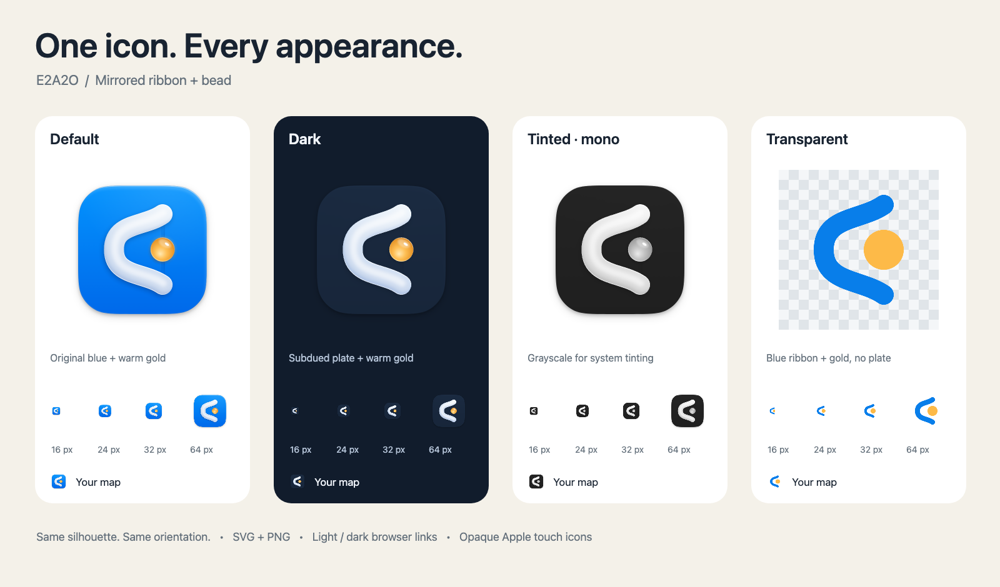

# Icon appearances

The supplied mirrored ribbon and bead are the source of every appearance. The original default PNGs and `ui/public/icon.svg` stay intact. Dark and tinted PNGs repaint the existing raster, preserving its lighting and silhouette; the SVG variants preserve the source vector geometry.

- **Default:** blue plate, white ribbon, gold bead.
- **Dark:** subdued blue-black plate, white ribbon, gold bead.
- **Tinted:** grayscale plate, ribbon and bead; the monochrome SVG is a solid foreground mask with a transparent background.
- **Transparent:** blue ribbon and gold bead without the plate, in SVG and 1024 px PNG.

`ui/public/icons/` includes 192/512 px install icons, full-bleed 180 px Apple touch icons, full-bleed 1024 px default/dark/tinted exports and the transparent export. The 1024 px raster exports scale the supplied 512 px master; they are not a newly drawn high-resolution master. For a native Apple asset catalog, use the three square 1024 px exports in its default, dark and tinted slots and let the system apply its mask. The transparent foreground is available separately for layered composition.

Both HTML entry points select light/dark favicons. `appearance.ts` selects the corresponding manifest and Apple touch icon at startup and on system appearance changes. Both manifests retain the same app identity and expose a `monochrome` mask. Apple touch icons remain opaque. The shared `AppMark` switches its image with the system appearance; the always-dark Agent work page uses the dark mark.

Web icons are not a native Icon Composer bundle. Installed web-app icon refresh and Home Screen tinting are controlled by the OS; selecting a page appearance does not promise that an already-installed icon changes immediately. Safari's SVG support is described in [WebKit's Safari 26 notes](https://webkit.org/blog/17333/webkit-features-in-safari-26-0/#svg-icons); native appearance slots follow [Apple's app icon guidance](https://developer.apple.com/design/human-interface-guidelines/app-icons/).

Rebuild derivatives and the sheet with `node scripts/icon-set/export.mjs`. After `npm run build --prefix ui`, run the focused check with `node scripts/icon-set/check.mjs`. Both use a separate headless Chrome profile and debugging pipes, with no listening ports, microphone or model access.
